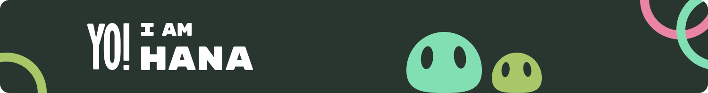

 

I am a young Computer Science graduate who enjoys
learning new things every day, and I would like my work
to contribute to solutions that can benefit others.

---

### My current projects

I am currently working on a self-host application to handle your shopping through multiple supermarket easily. It's currently a private repository which I'll put in public in a near future ;3

I am also working on my new dotfiles which are made using Ansible! I am making them for my transition from fedora to arch linux.

On the side I am learning the Rust programming language following the offical documentation book. I am really excited to make projects with this amazing and original language!

---

### I love using

### I am learning

 