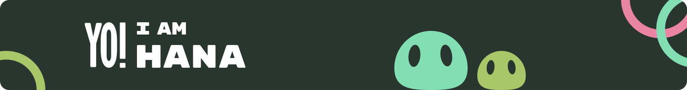

 
 

I am a young Computer Science graduate who enjoys
learning new things every day, and I would like my work
to contribute to solutions that can benefit others.

 

---

 

### I love using

 

### I am learning

 
 